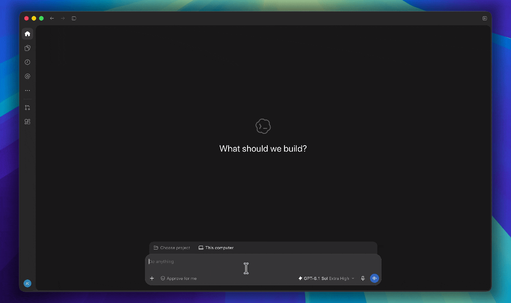

# Market Brief

An agent skill for source-backed market briefs across **China A-shares, U.S. equities,
and Crypto**. A curated library of 11 complete research prompts, ready to use.

[](https://github.com/bitpunklabs/market-brief/actions/workflows/ci.yml)
[](LICENSE)

<a href="media/market-brief-demo.gif">
  
</a>

Ask for a brief, then read what changed, why it matters, and what to watch next.

## Install

In Codex or another skill-capable agent with file and web-search access, paste:

```text
Install market-brief from:
https://github.com/bitpunklabs/market-brief

SKILL.md is at the repository root. Install the complete skill, including
assets/prompts, in this agent's personal skills directory. Confirm the
skill is discoverable.
```

Prefer a download? Get the ZIP from [Releases](https://github.com/bitpunklabs/market-brief/releases/latest),
unzip it, and ask your agent to install the complete `market-brief` folder.

Start a new conversation after installation. If the skill does not appear, restart
the agent. Fresh market research needs web search and source access; the skill
itself has no Python, API key, or package-installation requirement.

<details>
<summary>Terminal installation</summary>

For Codex:

```sh
git clone https://github.com/bitpunklabs/market-brief.git ~/.agents/skills/market-brief
```

For a project-only installation, use `.agents/skills/market-brief` in that project.
Choose one location to avoid duplicate entries. Other agents use their own skills
directory. See the [official Codex guide](https://learn.chatgpt.com/docs/build-skills#where-codex-loads-local-skills).
`main` tracks development; pin a reviewed commit or release tag for a fixed version.

</details>

## Use

> **For best results, use an advanced model with high reasoning effort.**
> Output quality cannot be guaranteed with lightweight models or low-effort settings.
> Select the model and effort in your assistant's settings before running the skill.

```text
$market-brief Prepare a China A-share premarket brief.
$market-brief Review last week's U.S. equity market, focusing on earnings.
$market-brief Give me a Crypto Daily Brief in Chinese.
```

Choose a market and period. Ask in your own words; the skill selects the matching
prompt and produces the report directly.

| Market | Before trading | After trading / daily | Weekly | Monthly | Default language |
| --- | --- | --- | --- | --- | --- |
| China A-shares | [Premarket](assets/prompts/A股盘前prompt.md) | [Postmarket](assets/prompts/A股盘后prompt.md) | [Review](assets/prompts/A股周度复盘prompt.md) | [Review](assets/prompts/A股月度复盘prompt.md) | Chinese |
| U.S. equities | [Premarket](assets/prompts/us-premarket-prompt.md) | [Postmarket](assets/prompts/us-postmarket-prompt.md) | [Review](assets/prompts/us-weekly-review-prompt.md) | [Review](assets/prompts/us-monthly-review-prompt.md) | English |
| Crypto | — | [Daily](assets/prompts/crypto-daily-brief-prompt.md) | [Review](assets/prompts/crypto-weekly-review-prompt.md) | [Review](assets/prompts/crypto-monthly-review-prompt.md) | English |

Add a date, information cutoff, language, focus, or watchlist when needed. Without
a date, the prompt selects the relevant session or completed period at research time.
A focus adds attention; say **only** to restrict coverage. Attach an earlier brief
if you want its judgments reviewed against subsequent developments.

## Output

The complete brief appears in your conversation. Ask to save a Markdown file when
you want to keep or share it.

Each report includes key conclusions, market and sector analysis, relevant company
or protocol developments, an outlook, and events or risks to watch. Important facts
have sources; the report states its research period and information cutoff.
The selected prompt sets the depth appropriate to the market and period.

Model capability and source access affect results. Missing data should be identified
where it affects a judgment. Historical research uses information available by its
cutoff. Without web access, the assistant can export prompts or provide clearly
labeled non-current analysis.

## Prompt library

Prefer to copy and paste? Open a prompt from the table, click **Copy raw file** in
GitHub's file toolbar, and paste the full text into an AI assistant with web search.
Add your date, language, or focus before the prompt. No skill installation is needed.

You can also ask `$market-brief Show me the U.S. weekly prompt` to export it.
The files in [`assets/prompts/`](assets/prompts/) are the single maintained source;
ordinary brief generation leaves them unchanged.

## Development

Read [SKILL.md](SKILL.md) and [Contributing](CONTRIBUTING.md). Keep prompt changes
focused on demonstrated problems and preserve each prompt's independent usability.
Development checks use Python 3.10+ and the standard library:

```sh
python scripts/check.py
python -m unittest discover -s tests -v
```

[Release packaging](CONTRIBUTING.md#releases) · [Changelog](CHANGELOG.md) ·
[Report a problem](https://github.com/bitpunklabs/market-brief/issues) ·
[Security](SECURITY.md)

License: [MIT](LICENSE). These are research briefs, not investment advice.
Package checks validate structure and integrity, not the accuracy of market judgments.
