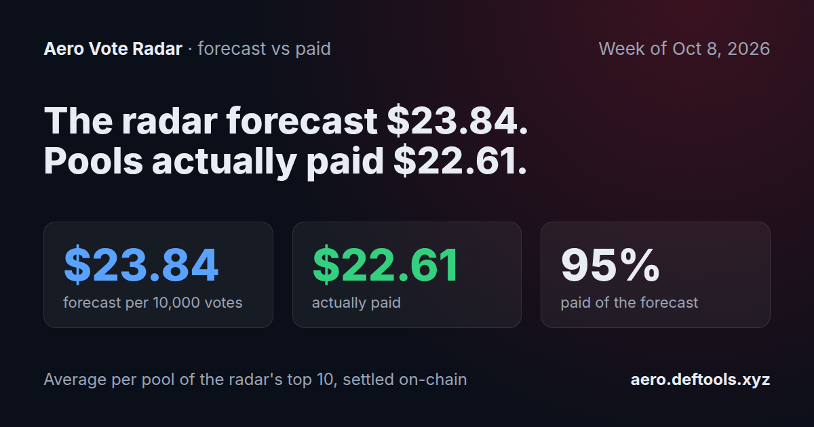

# aero-vote-radar

### You hold sAERO. Which pools pay you the most?

Aerodrome became **Aero** on October 22, 2026. Weekly veAERO voting is gone:
you stake AERO as **sAERO**, allocate it to pools on any of Aero's seven
networks, and earn those pools' fees and incentives, split by how much sAERO
each pool holds. You can move a stake again 47 hours after you last allocated
it on a network.

This radar answers one question from live on-chain data: **where does your
sAERO earn the most per day, after your own stake dilutes the pool?**

[](https://github.com/araxis33/aero-vote-radar/actions/workflows/ci.yml)
[](https://aero.deftools.xyz)
[](https://www.npmjs.com/package/aero-vote-radar)
[](LICENSE)

[](https://aero.deftools.xyz)

### Three ways to run it

| | |
|---|---|
| **Web page** | **[aero.deftools.xyz](https://aero.deftools.xyz)**: nothing to install. Type your sAERO or paste a wallet. |
| **CLI** | `npx aero-vote-radar recommend --amount 25000`: the same figures in a terminal. |
| **MCP server** | `npx aero-vote-radar-mcp`: three tools for Claude or any MCP agent. *"Where should my 25,000 sAERO go on Aero?"* |

All three read the same hourly scan, so a pool ranks the same everywhere.
No API keys, no wallet connection, no signatures: it reads, you allocate.

## What it does

- **Prices your own dilution.** A pool paying $100 a day to 90,000 sAERO pays
  your 10,000 sAERO $10, not the $11 the pre-stake rate suggests. Every figure
  is what *your* amount earns once it joins the pool.
- **Splits a large stake.** Past a certain size, a second pool beats piling
  more into the first. The split is built in 5% steps, each going where it adds
  the most, and kept to at most 3 pools so it can be typed into Aero by hand.
- **Shows which pools keep paying.** Each hour's rate is kept for a week. A pool
  is *steady* when at least 75% of 24+ hourly samples paid half its own average
  or more. A pool that paid once in a burst doesn't make that list.
- **Reads your wallet.** Your stakes, where each one is allocated on every
  network, its 47 h timer there, and what your current split pays a day
  against the suggested one.
- **Shows where the best allocators are pointed.** The 10 sAERO positions
  (10,000+) that earned the most per sAERO over the last 7 days
  ([dromos.kitchen](https://dromos.kitchen)'s ranking), with each one's current
  split read live from the LeafVoters — on the web page, under "What the top
  allocators hold now".

## How the figures are made

A GitHub Actions job (`.github/workflows/v3.yml`) scans Aero's contracts on
**Base, Ethereum, OP Mainnet, Arbitrum, Ink, Robinhood Chain and Arc** every
hour at :47 and publishes `docs/data/v3.json`, which the page, the CLI and the
MCP server all read:

- **Pools** come from each network's FactoryRegistry: gauge factories, then
  gauges, then their pools and rewards contracts.
- **Fees** are the `FeesCollected` events swept to each gauge's rewards contract
  over the last 96 hours (shorter in the first days after launch), turned into
  dollars per day with DefiLlama prices.
- **Incentives** are the programs streaming right now, at their per-second rate.
- **Allocated sAERO** is the gauge's weight on the LeafVoter.
- **Your share per day** = (fees + incentives) × your sAERO ÷ (pool's sAERO + your sAERO).
- Pools with under **100,000 sAERO** allocated are left out: one stake would
  move their rate.

The wallet lookup reads Aero's contracts directly (`app.aero.xyz/docs/security`):
stakes from the VotingEscrow on Base, and on every network that network's
LeafVoter for the stake's split and timer
(`lastAllocated + allocationCooldown − accumulatedCooldownReduction`).

**Rates move hour to hour.** Fees arrive in lumps and incentive programs start
and end. Treat any figure as today's rate, not a promise.

## Install

Requires Node.js 18.18 or newer.

```bash
npm install -g aero-vote-radar     # or skip this and use npx
```

From source:

```bash
git clone https://github.com/araxis33/aero-vote-radar
cd aero-vote-radar
npm install
npm run build
```

## CLI usage

```bash
npx aero-vote-radar pools                               # best pools for 10,000 sAERO, all networks
npx aero-vote-radar pools --amount 250000 --chain base  # for your amount, one network
npx aero-vote-radar pools --steady                      # only pools that kept paying
npx aero-vote-radar recommend --amount 250000           # suggested split
npx aero-vote-radar recommend --address 0xYourWallet    # split for your stake + your timers
npx aero-vote-radar my-stakes 0xYourWallet              # stakes, allocations, timers
```

`--chain` takes `base`, `ethereum`, `optimism`, `arbitrum`, `ink`, `robinhood`
or `arc`. Add `--json` to any command for machine-readable output.

Example (live, 2026-10-25):

```
Suggested split for 250,000 sAERO:

%   Pool                  Type  Network                sAERO     You/day
50  WETH/REI              CL100 Base                 125,000      $29.36
25  USDC/ULc              CL10  Base                  62,500      $15.63
25  USDC/SANc             CL10  Base                  62,500      $15.54

About $60.52 a day in total, at today's rates.

Enter it on https://app.aero.xyz/markets/allocate (Aero has no link that pre-fills a split).
```

## As an MCP server

```bash
npx aero-vote-radar-mcp        # from a clone: npx tsx src/mcp-server.ts
```

In Claude Code: `claude mcp add aero-vote-radar -- npx -y aero-vote-radar-mcp`.
An agent should read [`SKILL.md`](SKILL.md) first. Tools:

- **`list_pools`**: pools ranked by what an amount of sAERO earns a day after
  dilution. Optional `chain`, `top`, `steadyOnly`.
- **`recommend_allocation`**: the split for an `amount`, or for a wallet
  `address` (then also its current split and 47 h timers).
- **`get_my_stakes`**: a wallet's stakes, allocations per network, timers and
  what its current split pays.

Example prompts:

- *"Using aero-vote-radar, where should 50,000 sAERO go?"*
- *"Check 0xMyWallet on Aero: when can I move my stakes, and is there a better split?"*
- *"Which Aero pools on Base have paid steadily this week?"*

## Configuration

| Variable | What it does |
|---|---|
| `AERO_RADAR_DATA_URL` | Read the scan from another copy of `v3.json` (default `https://aero.deftools.xyz/data/v3.json`). |
| `BASE_RPC_URL` | Your own Base RPC, tried first for wallet reads and used by the scan. |
| `V3_LOGS_RPC_URL` | RPC for the scan's fee logs on Base (default Tenderly's public gateway). |

## Project layout

```
src/
  radar.ts        ranking, dilution, the 5% split, steady pools (shared by CLI and MCP)
  stakes.ts       wallet reads: stakes, timers and allocations on 7 networks
  cli.ts          the aero-vote-radar command
  mcp-server.ts   the aero-vote-radar-mcp server
  v3.ts           scan of one network's Aero contracts
  v3-cli.ts       hourly scan of all 7 networks -> docs/data/v3.json + docs/llms.txt
  v3History.ts    hourly samples and the steady-pool rule
  v3Llms.ts       docs/llms.txt for AI assistants
  topAllocators.ts  dromos.kitchen's top sAERO positions and their live splits
  prices.ts       DefiLlama prices
docs/             the web page, its data and llms.txt (GitHub Pages)
```

## Testing

```bash
npm test
```

The tests cover the ranking and dilution maths, the split (5% steps, at most
3 pools, always 100%, spreading beats all-in for a large stake), the steady
rule, the scan and its fee window, wallet timers and current-split pay, flag
parsing and the CLI's exit codes, all with synthetic data and no network.
Live reads are checked by running the CLI and MCP server against mainnet.
CI (`.github/workflows/ci.yml`) runs the typecheck, build and tests on every push.

## License

MIT
